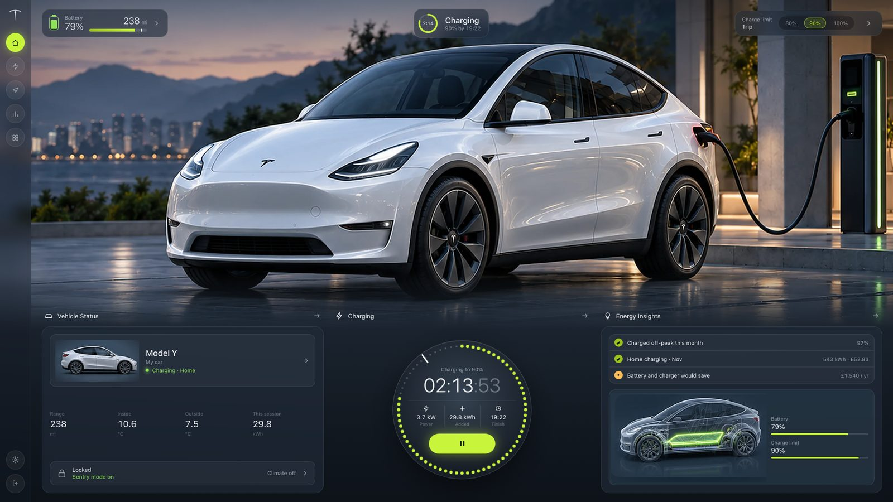
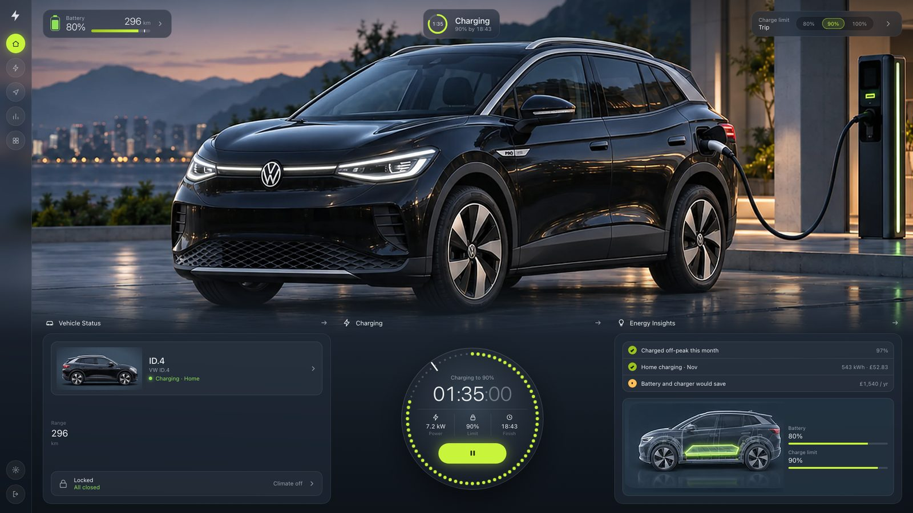
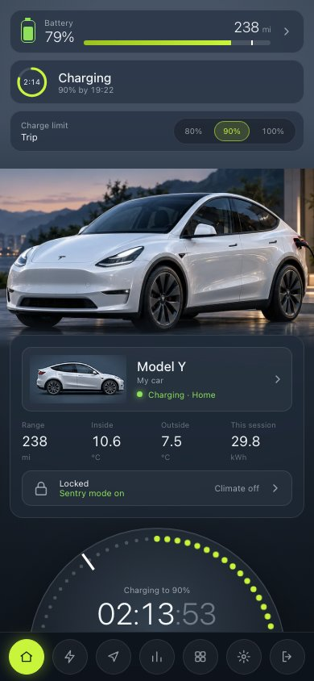
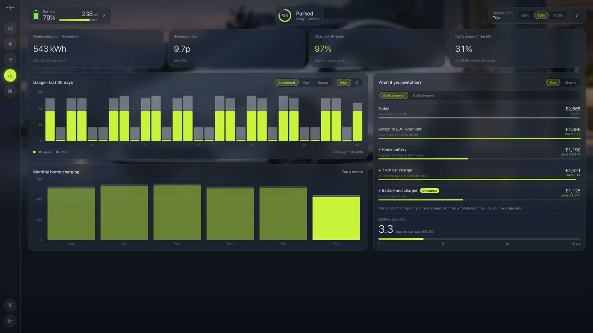

# EV Cockpit Card

A full-screen Home Assistant dashboard for your electric car. It shows charge, range and the
charging session at a glance, and has pages for charging controls, the car's location, energy
costs and remote controls. It is built to be cast to a Nest Hub or a TV and fits the screen without scrolling, and on phones it becomes an app-style layout with a bottom tab bar.



<p>
  
  
</p>



*Screenshots use example data.*

**Supported cars**

| Make | Integration | Status |
| --- | --- | --- |
| Tesla | [Tesla Fleet](https://www.home-assistant.io/integrations/tesla_fleet/), [Teslemetry](https://www.home-assistant.io/integrations/teslemetry/), Tessie | Tested with Tesla Fleet |
| Volkswagen ID. | An MQTT bridge with German entity names (tested on an ID.4); [We Connect ID](https://github.com/mitch-dc/volkswagen_we_connect_id) and Car-Net (early) | Charging, charge limit, climate and sync work through the car's buttons; the lock is read only |
| Any other car | Choose the entities yourself (`vehicle: generic`) | Works with whatever your car exposes |

## What it shows

- **Overview**: the car in its scene, battery and range, charging state, charge limit presets, vehicle status, a charging dial with a live countdown, and quick health checks.
- **Charging**: charge current, charge limit, start/stop, charge port, the session so far and today's tariff with off-peak hours.
- **Location**: a live map with the car and home, distance from home, and flash lights / honk horn.
- **Energy and costs** (optional): monthly home charging, the off-peak share, 30-day usage for the car and the house, and what a different tariff, a home battery or a faster home charger would save, worked out hour by hour from your own meter readings.
- **Controls**: doors, Sentry mode, climate and cabin temperature, defrost, front trunk, boot, windows, charge port, seat and steering wheel heaters.

Risky actions (unlocking, honking, opening the boot or front trunk) need a second tap.

## Install

### HACS

1. In HACS, open the menu ⋮ → **Custom repositories**.
2. Add `https://github.com/Muji86/ev-cockpit-card` with the type **Dashboard**.
3. Find **EV Cockpit Card**, install it and reload the browser.

### Manual

Copy `dist/ev-cockpit-card.js` to `/config/www/` and add it under **Settings → Dashboards → ⋮ → Resources** as `/local/ev-cockpit-card.js` (JavaScript module).

## Set up

Make a new dashboard for the car, add a view with the **Panel** layout and add the card. The minimum is:

```yaml
type: custom:ev-cockpit-card
vehicle: tesla
```

The card finds the car by itself. Everything else can be set in the visual editor.

### Full screen and casting

With `fullscreen: true` (the default) the card covers Home Assistant's header and sidebar.
It steps aside while you edit the dashboard. Use the button at the bottom of its side bar to show Home Assistant's menus.

To cast it to a Nest Hub or a TV, use the **Home Assistant Cast** integration and the `cast.show_lovelace_view` action:

```yaml
action: cast.show_lovelace_view
data:
  entity_id: media_player.kitchen_display
  dashboard_path: ev-cockpit
  view_path: car
```

### On phones

On a phone (or any screen under 760 px wide or 500 px tall) the sections stack and scroll inside the card,
with a tab bar at the bottom. In the Home Assistant Companion app, give the car its own dashboard so the card
can use the whole screen.

### Energy and costs

These pages need a statistic that counts the car's home charging in kWh (for example a
utility meter on the car's charge energy) and, for the comparisons, your whole-house meter.

```yaml
type: custom:ev-cockpit-card
vehicle: tesla
currency: "£"
tariff:
  offpeak_rate: 0.09        # per kWh
  peak_rate: 0.31
  offpeak_start: 0          # hour, local time
  offpeak_end: 5
  standing_charge: 0.4705   # per day
energy:
  car_statistic: sensor.my_car_home_charging
  home_statistic: sensor.electricity_meter_energy
compare:                    # optional: a tariff to compare with
  name: EDF overnight
  offpeak_rate: 0.066
  peak_rate: 0.36
  offpeak_start: 23
  offpeak_end: 6
home_battery:               # optional: home batteries to compare
  preset: fogstar           # Fogstar 16.1 kWh + inverter bundles (the default when no kwh is given)
  install_cost: 2500        # added to each kit's price (default 2500 for the Fogstar bundles)
  usable: 0.95              # share of the capacity the inverter lets you use
  efficiency: 0.9           # round trip
ev_charger_kw: 7            # optional: a faster home charger to compare
```

The Fogstar preset compares one or two 16.1 kWh batteries (16 or 32 kWh) with a 6 kW inverter (the GEN3 3.6–6K)
or an 8 kW one (the GEN PRO 7–12K), at their November 2026 prices: the 16.1 kWh bundles are £2,625.99 and £3,165.99,
and a second battery is £1,719.99. Pick the size and inverter on the card. `batteries: [1, 2]`, `inverters: [6, 8]` and
`extra_battery_price` change the choices. **Quotes.** To compare real quotes, list them. The card shows a dropdown of them, and the one you picked last is
shown next time (remembered for your Home Assistant user). The total is the battery, inverter and installation
added together:

```yaml
home_battery:
  quotes:
    - source: Fogstar direct
      battery_kwh: 16.1
      usable_kwh: 15.3        # optional: what the battery lets you use (default 95%)
      battery_cost: 1719.99
      inverter_kw: 6
      inverter_cost: 906
      install_cost: 2500
    - source: Local installer
      battery_kwh: 32.2
      battery_cost: 3800
      inverter_kw: 8
      inverter_cost: 1200
      install_cost: 1800
```

They can also be added in the card's visual editor, under "Home battery to compare". To compare your own choices
without the dropdown, list them:

```yaml
home_battery:
  install_cost: 2500
  options:
    - { name: 16 kWh + 6 kW, kwh: 16.1, inverter_kw: 6, max_kw: 10, price: 2625.99 }
    - { name: 32 kWh + 12 kW, kwh: 32.2, inverter_kw: 12, max_kw: 20, price: 5500 }
```

The older form (`kwh`, `cost` for the installed price and `inverter_options`) still works.

**What if you switched?** has two views. **Costs** shows each option's yearly bill and how long the
battery takes to pay back its kit and installation. **Battery** goes through your real days with the chosen
battery: on how many days it covers the whole peak, when it usually runs out, and how much still comes from the
grid at peak. That grid energy is split into what's used after the battery runs out, what's above the inverter's power, and car
charging at peak (the battery runs the house, not the car). It also says how much usable storage would cover 9 days in 10,
and compares every inverter option. The battery charges in the off-peak hours as fast as the inverter allows
and tops up in any cheap daytime slot.

Tap any bar in the charts to see its numbers.

**No kWh counter for the car?** The card can work out home charging from the car's battery level
or its charging power instead:

```yaml
energy:
  car_source: soc                 # energy (default) | power | soc
  car_statistic: sensor.my_car_battery_level
  battery_kwh: 77                 # usable battery size, for soc
  charge_efficiency: 0.9          # share of the wall energy that reaches the battery
  home_statistic: sensor.electricity_meter_energy
  cost_statistic: sensor.electricity_meter_cost   # optional, see below
```

Each rise in battery level becomes the energy drawn from the wall, capped at what the house meter
recorded that hour, so charging away from home isn't counted. `power` treats each hour's average charging
power as that hour's kWh; only use it if the sensor drops to 0 when charging stops.

**Leave out old readings.** Set `energy.start_date: 2026-11-20` to ignore everything before that day, for example
days on a different tariff or a one-off that would skew the averages.

**Smart tariffs** (Octopus Intelligent, EDF GoElectric with Smart Charge and similar) add cheap slots outside
the usual off-peak hours. Set `energy.cost_statistic` to your supplier's hourly cost statistic (the Octopus
Energy integration makes one for Octopus and EDF) and the card prices every hour at the rate you actually paid.

**Use your supplier's own charging figures.** On Octopus Intelligent or EDF Smart Charge, the supplier reports
the kWh it put into the car for every half-hour slot. Point the card at that sensor and those figures replace the
estimate for as far back as Home Assistant keeps history (usually 10 days):

```yaml
energy:
  dispatch_entity: binary_sensor.octopus_energy_..._intelligent_dispatching
  measured_statistic: sensor.my_car_supplier_charging_energy   # optional, see below
```

Home Assistant only keeps that sensor's history for a few days. To keep the supplier's figures for longer,
make a kWh total of them (a sensor with `state_class: total`) and set it as `measured_statistic`: from the
hour it starts, it replaces the estimate too. Older months keep using `car_statistic`.

### All options

| Option | Default | What it does |
| --- | --- | --- |
| `vehicle` | `tesla` | `tesla`, `volkswagen` or `generic` |
| `device_id` | first car found | Which car to show when you have more than one |
| `name`, `model` | from the device | Text shown on the card |
| `fullscreen` | `true` | Cover the header and sidebar |
| `image`, `side_image`, `xray_image` | built-in pictures | Your own pictures (URLs, e.g. `/local/car.jpg`) |
| `currency` | `£` | Currency symbol; with `£`, rates show in pence |
| `limit_presets` | `[80, 90, 100]` | Charge limit buttons |
| `tariff`, `energy`, `compare`, `home_battery`, `ev_charger_kw` | | See above |
| `entities` | | Override any entity the card found, e.g. `entities: { battery: sensor.my_soc }` |

The **Settings** page in the card lists every entity it found, which helps when something is missing.

## Adding another car

See [CONTRIBUTING.md](CONTRIBUTING.md). A new make is usually one block in `src/10-adapters.js` plus three pictures.

## Pictures

The Tesla and Volkswagen pictures included are illustrations of those cars. Large screens (TVs, desktops, tablets) load a 4K version of the scene, installed by HACS next to the card or fetched from this repository's release if it is missing; phones use the smaller built-in one. Set `hires: false` to always use the built-in one. Tesla and Volkswagen are
trademarks of their owners; this project isn't affiliated with or endorsed by either company.
Set `image`, `side_image` and `xray_image` to use photos of your own car.

## Licence

MIT
